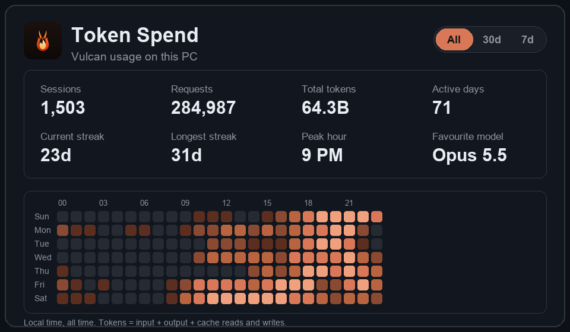
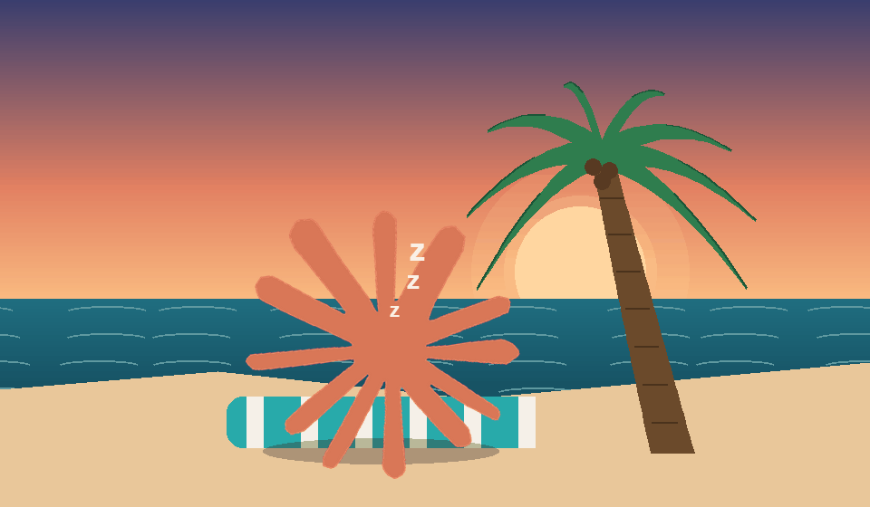

  

  

## Usage dashboard

<table>
  <tr>
    <td width="50%" valign="top"></td>
    <td width="50%" valign="top"></td>
  </tr>
</table>

Vulcan token use on this PC, from Aether's usage tracker. Tokens are the units AI models bill by.

| Window | Tokens | Requests | Sessions |
|---|---:|---:|---:|
| Last 7 days | 4.9B | 20,581 | 67 |
| Last 30 days | 25.7B | 113,365 | 347 |
| All time | 64.3B | 284,987 | 1,503 |

Estimated cost (USD) is not shown yet. Vulcan's tools do not return it.
